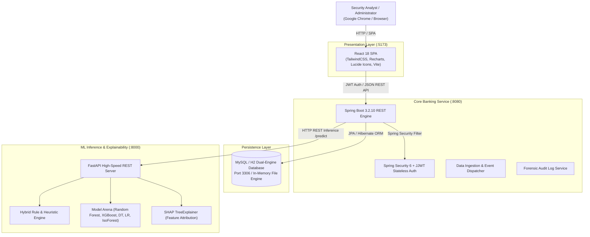

# FraudShield AI: Enterprise Financial Transaction Monitoring & Fraud Detection Platform

[](https://spring.io/projects/spring-boot)
[](https://www.oracle.com/java/)
[](https://www.python.org/)
[](https://fastapi.tiangolo.com/)
[](https://react.dev/)
[](https://tailwindcss.com/)
[](https://vitejs.dev/)
[](LICENSE)

**FraudShield AI** is an enterprise-grade, high-throughput financial surveillance, Anti-Money Laundering (AML), and transaction fraud detection system. Architected as a distributed microservice topology combining **Java 17/21 Spring Boot**, **Python FastAPI**, and **React 18**, it provides real-time fraud probability scoring, explainable AI (SHAP TreeExplainer), heuristic safety rules, and forensic incident triage.

---

## 🏛️ System Architecture



### Communication Flow
1. **Client to Backend (`:5173` -> `:8080`)**: React sends standard REST API requests authenticated with JSON Web Tokens (Bearer JWT in `Authorization` header). Vite provides a local reverse proxy for development.
2. **Backend to ML Inference Engine (`:8080` -> `:8000`)**: Spring Boot dispatches transaction feature payloads via `RestTemplate` with fail-safe fallback resilience to FastAPI.
3. **Inference & Explainability**: FastAPI extracts chronological features without data leakage, executes the active ensemble model (e.g. Random Forest / XGBoost), scores domain heuristic rules, and calculates exact SHAP attribution vectors.
4. **Data Persistence**: Spring Boot persists the scored transaction, audit trail records, and automatically opens critical triage alerts if the risk score crosses the alert threshold ($\ge 50$).

---

## 📊 PaySim Dataset Profile (Ingestion & Verification)

FraudShield AI was calibrated and evaluated against the verified **PaySim Synthetic Financial Dataset**:

| Metric | Verified Dataset Value | Notes |
| :--- | :--- | :--- |
| **Total Transactions** | **6,362,620** | Full transaction universe |
| **Legitimate Transactions** | **6,354,407 (99.8709%)** | Baseline commerce |
| **Fraudulent Transactions** | **8,213 (0.1291%)** | Extreme imbalanced ground truth |
| **Legacy Flagged Fraud** | **16 (0.00025%)** | Demonstrates failure of legacy static rules |
| **Missing Values** | **0 across all 11 columns** | Clean financial ledger schema |
| **Total Transaction Volume** | **\$1,144,392,944,759.77 (\$1.14 Trillion)** | High-density settlement network |
| **Fraud Volume** | **\$12,056,415,427.84 (\$12.05 Billion)** | Average fraud volume is 8.2× higher than normal |

### Transaction Type Vulnerability Breakdown
* **`CASH_OUT`**: 2,237,500 total | **4,116 frauds** (50.11% of all network fraud)
* **`TRANSFER`**: 532,909 total | **4,097 frauds** (49.89% of all network fraud)
* **`PAYMENT`**: 2,151,495 total | **0 frauds**
* **`CASH_IN`**: 1,399,284 total | **0 frauds**
* **`DEBIT`**: 41,432 total | **0 frauds**

> **Domain Insight**: In the PaySim network, 100% of financial crime occurs exclusively within **TRANSFER** (capital exfiltration) and **CASH_OUT** (liquidation) categories.

### 📥 Obtaining the PaySim Dataset
Due to GitHub repository size limits, the raw PaySim CSV file (`PS_20174392719_1491204439457_log.csv`, ~470 MB) is excluded from version control via `.gitignore`.
1. Download the dataset from [Kaggle PaySim Dataset](https://www.kaggle.com/datasets/ealaxi/paysim1).
2. Place the uncompressed CSV file in the project root directory:
   ```
   D:\Fraud - Detection - System\PS_20174392719_1491204439457_log.csv
   ```
3. *(Optional)* If the dataset is absent, the backend automatically seeds realistic fallback starter transactions so the entire platform works out of the box.

---

## 🤖 Machine Learning Model Arena

All models were evaluated on a chronological holdout test set (12,055 transactions with 1,902 ground-truth fraud instances) with strict data-leakage prevention:

| Algorithm | Precision | Recall | F1 Score | PR-AUC | ROC-AUC | False Positive Rate | Training Time | Latency |
| :--- | :---: | :---: | :---: | :---: | :---: | :---: | :---: | :---: |
| **Random Forest** ⭐ | **1.0000** | **0.9995** | **0.9997** | **1.0000** | **1.0000** | **0.0000** | 10.94s | 0.0045 ms |
| **XGBoost Classifier** | **1.0000** | **0.9995** | **0.9997** | **1.0000** | **1.0000** | **0.0000** | 4.05s | 0.0016 ms |
| **Decision Tree** | 0.9995 | 0.9989 | 0.9992 | 0.9991 | 0.9995 | 0.0001 | 3.54s | 0.0003 ms |
| **Logistic Regression** | 1.0000 | 0.9968 | 0.9984 | 1.0000 | 1.0000 | 0.0000 | 1.19s | 0.0001 ms |
| **Isolation Forest (Anomaly)** | 0.3028 | 0.8885 | 0.4516 | 0.7615 | 0.8929 | 0.3833 | 7.49s | 0.0253 ms |

### Feature Engineering & Anti-Leakage Protocol
* **Target Isolation**: `isFraud` is used strictly as a training label and never provided during inference.
* **Legacy Exclusion**: `isFlaggedFraud` is discarded to prevent model reliance on flawed legacy systems.
* **No Post-Transaction Fields**: `newbalanceOrig` and `newbalanceDest` are excluded because in real-time banking pipelines, settling balances are unknown until the transaction is executed.
* **Engineered Signals**: Temporal step dynamics, log amount, balance drain delta, zero origin/destination balance indicators, and account type prefix indicators (`dest_is_merchant`).

---

## 🔐 Demo Credentials & RBAC

| Role | Username | Password | Permissions |
| :--- | :--- | :--- | :--- |
| **Administrator** | `admin` | `Admin@123` | Full administrative control, Model switching, Audit logs, Risk settings |
| **Security Analyst** | `analyst` | `Analyst@123` | Real-time transaction scoring, Incident triage, Case docket management |

*(1-click demo login buttons are provided directly on the Login screen for instant access)*

---

## 🖥️ Platform Modules & UI Capabilities

1. **Executive Surveillance Dashboard**: Real-time KPI summary cards, time-series volume trend charts, transaction distribution donuts, vulnerability matrix, and risk tier histograms.
2. **Real-Time Detection Studio**: Interactive sandbox to score ad-hoc transactions with preloaded high-risk liquidation and benign merchant benchmarks.
3. **Transaction Explorer**: High-density ledger table with real-time text search, type filters, risk categories, server-side pagination, and CSV export.
4. **Fraud Alert Management**: Dedicated triage queue for Critical, High, and Medium severity incidents with investigation status controls (`OPEN`, `UNDER_INVESTIGATION`, `RESOLVED`, `FALSE_POSITIVE`).
5. **Explainable AI (XAI)**: SHAP waterfall contribution charts displaying exact feature weights driving the probability prediction.
6. **ML Model Arena**: Side-by-side benchmark comparison of all 5 algorithms with live model-switching capability.
7. **Customer Behavioral Analytics**: Profile transaction velocity, cumulative volume, and risk historical patterns per account ID.
8. **Investigation Center**: Case docket management, evidence dossiers, and analyst review notes.
9. **Audit Trail**: Immutable compliance log recording every login, model change, and scored transaction.
10. **System Settings**: Configurable risk tier thresholds (Low, Medium, High, Critical) and heuristic rule toggles.

---

## 📡 REST API Reference

### Spring Boot Backend (`http://127.0.0.1:8080`)
* `POST /api/auth/login` – Authenticate user and issue JWT token.
* `POST /api/auth/register` – Register a new analyst or admin.
* `GET  /api/auth/me` – Retrieve the authenticated user profile.
* `GET  /api/dashboard/stats` – Aggregated platform metrics and risk distribution.
* `GET  /api/transactions` – Filtered and paginated transaction ledger.
* `GET  /api/transactions/{id}` – Transaction detail by transaction ID.
* `POST /api/transactions/predict` – Score a transaction, persist record, and dispatch alert if high-risk.
* `GET  /api/transactions/export` – Export transactions as CSV download.
* `GET  /api/alerts` – Filtered list of security alerts.
* `PUT  /api/alerts/{id}/status` – Update alert triage status.
* `GET  /api/alerts/stats` – Summary of open/investigating/resolved alerts.
* `GET  /api/ml/models` – Benchmark statistics of all trained models.
* `POST /api/ml/models/select?modelName={name}` – Hot-swap the active production model.
* `GET  /api/ml/dataset/profile` – Verified PaySim dataset profile.
* `GET  /api/customers` – Customer risk profiles and transaction histories.
* `GET  /api/audit-logs` – Immutable security audit trail.

### FastAPI Machine Learning Engine (`http://127.0.0.1:8000`)
* `GET  /health` – Health check, active model status, and loaded feature count.
* `POST /predict` – Real-time transaction scoring with SHAP explainability.
* `POST /batch-predict` – Batch inference endpoint.
* `GET  /models` – Algorithm comparison metrics report.
* `POST /models/select?model_name={name}` – Switch active ML algorithm in memory.
* `GET  /dataset/profile` – Dataset metadata and profile metrics.
* `GET  /docs` – Interactive Swagger OpenAPI documentation.

---

## ⚡ Quick Start & Execution

### Prerequisites
* **Java**: OpenJDK 17 or 21
* **Maven**: 3.8+ (or use the included wrapper script)
* **Python**: 3.11, 3.12, or 3.14
* **Node.js**: v18+ and npm v9+
* **Browser**: Google Chrome, Edge, or Firefox

### One-Click Multi-Service Startup (Recommended)
Run the PowerShell startup script from the root workspace:
```powershell
.\start-all.ps1
```
Or from Command Prompt:
```cmd
start-all.bat
```

### Manual Service-by-Service Startup

#### 1. Machine Learning Inference Service (Port 8000)
```bash
cd ml-service
python -m venv fenv
# Windows:
.\fenv\Scripts\activate
# Linux/macOS:
source fenv/bin/activate

pip install -r requirements.txt
python -m uvicorn app:app --host 127.0.0.1 --port 8000
```
*API Swagger Docs: [http://127.0.0.1:8000/docs](http://127.0.0.1:8000/docs)*

#### 2. Java Spring Boot Backend (Port 8080)
```bash
cd backend
# Windows:
.\mvnw.cmd spring-boot:run
# Linux/macOS:
./mvnw spring-boot:run
```
*Backend Base URL: [http://127.0.0.1:8080](http://127.0.0.1:8080)*  
*H2 Console: [http://127.0.0.1:8080/h2-console](http://127.0.0.1:8080/h2-console)*

#### 3. React Frontend Application (Port 5173)
```bash
cd frontend
npm install
npm run dev -- --host 127.0.0.1 --port 5173
```
*Web Application UI: [http://127.0.0.1:5173](http://127.0.0.1:5173)*

---

## 📁 Repository Directory Structure

```
FraudShield-AI-Fraud-Detection-System/
├── .gitignore                    # Comprehensive ignore rules (datasets, venv, node_modules)
├── README.md                     # Enterprise platform documentation
├── dataset_profile.json          # Verified PaySim dataset analytics report
├── inspect_dataset.py            # Dataset verification & chunk-processing profiler
├── start-all.bat                 # Windows CMD one-click launcher
├── start-all.ps1                 # PowerShell one-click multi-service launcher
│
├── backend/                      # Java Spring Boot 3.2.10 Backend
│   ├── mvnw                      # Linux/macOS Maven wrapper
│   ├── mvnw.cmd                  # Windows Maven wrapper
│   ├── pom.xml                   # Maven dependencies & build configuration
│   └── src/
│       ├── main/
│       │   ├── java/com/fraudshield/ai/
│       │   │   ├── FraudShieldApplication.java
│       │   │   ├── controller/   # REST Controllers (Auth, Txn, Alerts, ML, Dashboard)
│       │   │   ├── dto/          # Data Transfer Objects
│       │   │   ├── entity/       # JPA Entities (User, Transaction, Alert, Audit)
│       │   │   ├── repository/   # Spring Data JPA Repositories
│       │   │   ├── security/     # Spring Security, JWT Provider & Auth Filters
│       │   │   └── service/      # Business Services & ML Client Integration
│       │   └── resources/
│       │       ├── application.yml        # Default configuration (H2 / Embedded)
│       │       └── application-mysql.yml  # MySQL production configuration
│       └── test/
│           └── java/com/fraudshield/ai/FraudShieldApplicationTests.java
│
├── frontend/                     # React 18 + TailwindCSS + Vite Single Page App
│   ├── index.html                # Application entry HTML
│   ├── package.json              # NPM dependencies & scripts
│   ├── postcss.config.js         # PostCSS configuration
│   ├── tailwind.config.js        # Custom Tailwind styling & color tokens
│   ├── vite.config.js            # Vite configuration & backend proxy
│   └── src/
│       ├── App.jsx               # Main application router & layout
│       ├── index.css             # Tailwind base & glassmorphism theme styles
│       ├── main.jsx              # React DOM bootstrap
│       ├── components/           # Reusable UI components (Navbar, Sidebar)
│       ├── context/              # Authentication context & JWT state
│       ├── pages/                # Views (Dashboard, Prediction, Alerts, XAI, Models)
│       └── services/api.js       # Centralized REST API client
│
└── ml-service/                   # Python FastAPI Machine Learning Inference Engine
    ├── app.py                    # FastAPI application & REST endpoints
    ├── requirements.txt          # Python dependencies
    ├── train_models.py           # Training pipeline for 5 ML algorithms
    ├── models/                   # Pretrained model artifacts (.joblib, .json)
    │   ├── best_model.json       # Active model pointer
    │   ├── feature_names.json    # Exact feature column ordering
    │   ├── decision_tree.joblib
    │   ├── isolation_forest.joblib
    │   ├── logistic_regression.joblib
    │   ├── random_forest.joblib
    │   ├── scaler.joblib
    │   ├── shap_background.joblib
    │   ├── shap_explainer.joblib
    │   └── xgboost.joblib
    └── reports/                  # Model evaluation metrics & reports
        └── model_comparison.json # Cross-algorithm performance comparison
```

---

## 🛡️ License
This project is open-source under the [MIT License](LICENSE). Developed for enterprise financial security, AML surveillance, and educational demonstration.
